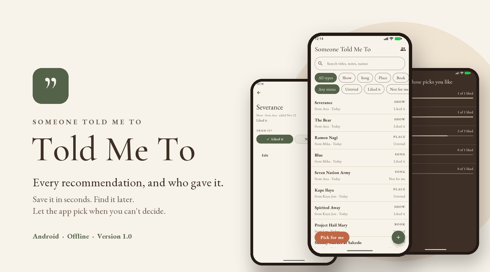
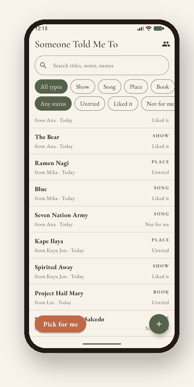
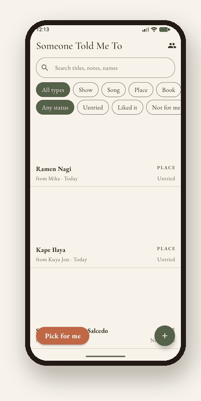
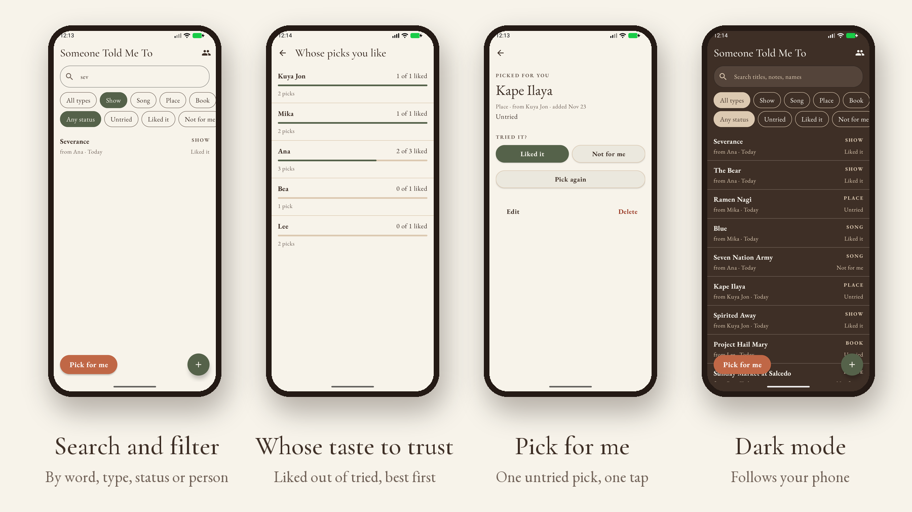

<p align="center">
  
</p>

<h1 align="center">Told Me To</h1>

<p align="center">
  <b>Someone Told Me To</b> keeps the shows, songs, books and places your friends recommend, along with who recommended them.<br>
  Offline Android app. No account, no setup.
</p>

<p align="center">
  <a href="../../releases/latest"><b>Download the APK (v1.0)</b></a>
</p>

---

Ana tells you to watch something. Kuya Jon names a ramen place. Mika sends a song. A week later you remember none of it, or you remember the title but not who said it. Notes and screenshots keep the words and lose the context.

Told Me To saves each pick with the person behind it, in two fields. After you try it, one tap says whether it was good. Over time the app knows whose taste matches yours.

<table>
  <tr>
    <td align="center" width="33%"><br><b>Save it in seconds</b><br>What it is and who told you. Names fill in as you type.</td>
    <td align="center" width="33%"><br><b>Pick for me</b><br>Free evening? One tap picks something you haven't tried.</td>
    <td align="center" width="33%"><br><b>Find it again</b><br>Search a word, filter by type or status, or by person.</td>
  </tr>
</table>

<p align="center"></p>

## What it does

- **Two-field quick add.** Title and person. Type, note and link are optional.
- **Share to Quick Add.** Share a Google Maps or Instagram link from any app and it lands in the Link field.
- **Liked it / Not for me.** One tap after you try something.
- **Whose picks you like.** Each person gets a score, liked out of tried, best first.
- **Pick for me.** A random untried pick, optionally just Places or just Shows. Pick again for another.
- **Search and filter.** By word, type, status or person, combined.
- **Works as a "to go" list.** Filter by Place and you have every cafe and spot friends told you about.
- **Light and dark**, large text, TalkBack labels, 48dp touch targets.

Everything stays on the phone in a small SQLite database. The app has no internet permission.

## Install

1. Download `SomeoneToldMeTo.apk` from the [latest release](../../releases/latest).
2. Open it on an Android 8.0+ phone and allow the install.

## Build from source

Requires Android Studio (it bundles the JDK the build needs). Clone the repo, open the folder in Android Studio and press Run, or from a terminal:

```
./gradlew assembleDebug                 # build
./gradlew testDebugUnitTest             # 15 unit tests
./gradlew connectedDebugAndroidTest     # 12 database tests, needs an emulator or phone
```

## How it's built

Kotlin, XML layouts with Material Components 3, and plain `SQLiteOpenHelper`. Four screens (List, Add/Edit, Detail, People) pass ids to each other with explicit Intents. All SQL lives in one repository; the input rules, Pick for me and ranking are plain Kotlin with unit tests.

| Folder | What's in it |
|---|---|
| `app/src/main/java/.../ui` | The four screens and shared pieces (success panel, pop-out confirm panel, smooth scrolling) |
| `app/src/main/java/.../data` | Database setup and every query |
| `app/src/main/java/.../model` | What a pick is, input rules, Pick for me, trust ranking |
| `docs/` | Test log and the images in this README |

Built as the final project for CS0011 Mobile Programming. Version 1.0 passes all 12 planned test cases; 7 defects found during testing were fixed and are recorded in [docs/test-log.md](docs/test-log.md).
